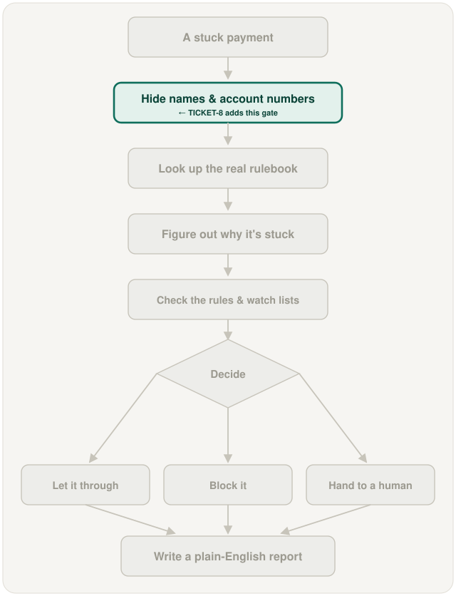

# PII masking guardrail and red-team test, in plain words

## What is this task?

This task adds a gate that every payment passes through before any AI step
sees it. The gate swaps every real name, account number and bank code for a
stand-in label like `PARTY_1` or `ACCOUNT_2`. A test then tries to sneak
personal details past the gate and proves none of them get through.

## Why does it exist?

Each payment's form (the pain.001 message from TICKET-1) has the full names
and bank account numbers of both people. Without this gate, the first agent
built (TICKET-5) would paste all of that straight into an AI prompt. A real
bank could never allow that, and "we told the AI not to repeat it" is a
promise, not proof.

## What changes because of it?

Personal details stop at the door: every later agent (Triage, Compliance,
Audit) only ever works with the masked version, so privacy no longer depends
on each agent behaving well. The project also gains a test that shows a
reviewer exactly what the AI was sent, with no personal details in it. The automatic checks
(TICKET-11) will run that test on every code change.

## This task's own workflow

In words: a stuck payment arrives with real names and account numbers → each
one is swapped for a stand-in label (the same name always gets the same label
within one payment, so the AI can still tell "the payer" from "the payee") →
only that masked version is allowed into an AI prompt → the AI reasons with
labels only. Alongside, a red-team test plants fake personal details in a
payment, captures the exact prompt the AI receives and the answer it gives,
and fails if a single planted detail shows up in either.

## Where it fits in the whole project

The highlighted box is a new step, not an existing one made better. It sits
between "a stuck payment arrives" and everything that involves AI, so it
protects every later step at once.

**Worth knowing before planning:** checking the watch lists (TICKET-6)
means comparing the payee's *real* name against the sanctions list. That
comparison has to happen in plain code before the gate, or through the gate's
private lookup table, and never by showing the AI the real name. The
implementation plan has to decide which way to do it.

## Screenshots

This task has no screen to photograph. It's a privacy filter and a test
suite, not something with a visible interface, and no agent exists yet to
show a prompt before and after masking. The two diagrams above are the
workflow view for now.

## New terms this task introduces

- **PII (personally identifiable information)**: any detail that points to a
  real person or business, such as a name, a bank account number (IBAN) or a
  bank code (BIC).
- **Masking (tokenizing)**: replacing each personal detail with a meaningless
  stand-in label. A private lookup table, never shown to the AI, remembers
  which label stands for which real value.
- **Guardrail**: a safety check built into the code itself, so it holds even
  if an AI misbehaves. It's the opposite of a polite instruction in a prompt.
- **Red-team test**: a test that plays the attacker. Here it deliberately
  hides personal details in a payment and checks the guardrail catches every
  one.
- **Prompt boundary**: the exact point where text is handed to an AI. This
  task makes sure nothing unmasked ever crosses it.
